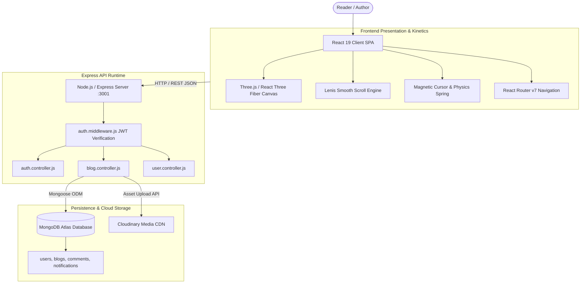

# Full Project Analysis: Next-Gen Creative Blog Platform

## 0.1 What the Project Is
The **Next-Gen Creative Blog Platform** is an enterprise-grade, visually immersive storytelling portal designed for developers, technical writers, and digital artists. 

Unlike traditional static blogging engines (e.g., standard WordPress or Medium clones), this platform blends editorial publishing with interactive 3D WebGL spatial computing and kinetic micro-physics. Readers explore articles in a fluid, frictionless environment powered by 60fps inertial smooth scrolling, real-time reactive 3D canvas backgrounds, magnetic cursor physics, and instant live search. Authors write in a rich draft studio featuring automatic slug generation, multi-tag categorization, Cloudinary media CDN integration, and real-time community engagement loops (nested comments, applause claps, and notification feeds).

## 0.2 System Architecture Diagram

## 0.3 Inventory Counts
- **Total Pages**: 8 (`home.jsx`, `feed.jsx`, `blogdetail.jsx`, `createblog.jsx`, `myposts.jsx`, `profile.jsx`, `search.jsx`, `login.jsx`, `signup.jsx`)
- **Total Components**: 8 (`scene3d.jsx`, `cursor.jsx`, `magnetic.jsx`, `navbar.jsx`, `smoothscroll.jsx`, `pagewrapper.jsx`, `search.jsx`)
- **Backend Endpoints**: 18 REST endpoints
- **Database Collections / Models**: 4 (`User`, `Blog`, `Comment`, `Notification`)
- **Third-Party Integrations**: 2 (MongoDB Atlas, Cloudinary Media CDN)
- **Environment Variables**: 6 (`PORT`, `MONGO_URL`, `JWT_SECRET`, `CLOUDINARY_CLOUD_NAME`, `CLOUDINARY_API_KEY`, `CLOUDINARY_API_SECRET`)
