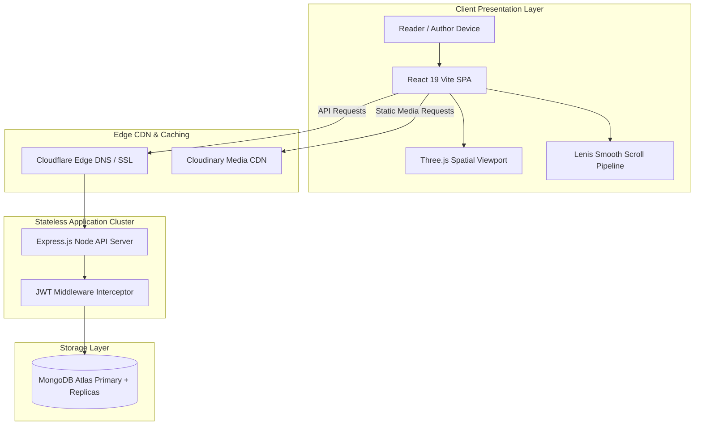

# System Architecture & Request Lifecycle

## High-Level Architecture
The application is structured as a decoupled, multi-tier Single Page Application (SPA) communicating with a stateless Node.js / Express REST API backed by MongoDB Atlas and Cloudinary Media CDN.

## Scaling to 100x Load: The First Three Bottlenecks
1. **MongoDB Query Contention on Blog Feeds**: High read volume on `/api/v1/blogs` will bottleneck the database. *Mitigation*: Introduce Redis caching with cache-aside pattern and 60-second TTL.
2. **Node.js Single-Threaded CPU Saturation on Password Hashing**: `bcrypt` CPU work during traffic spikes can block the event loop. *Mitigation*: Offload auth processing to dedicated worker threads or an external auth gateway.
3. **Heavy WebGL Canvas Initialization on Low-Power Mobile Devices**: High draw calls degrade mobile battery. *Mitigation*: Add device capability detection (`navigator.hardwareConcurrency`) to automatically disable 3D canvas on low-end hardware.
