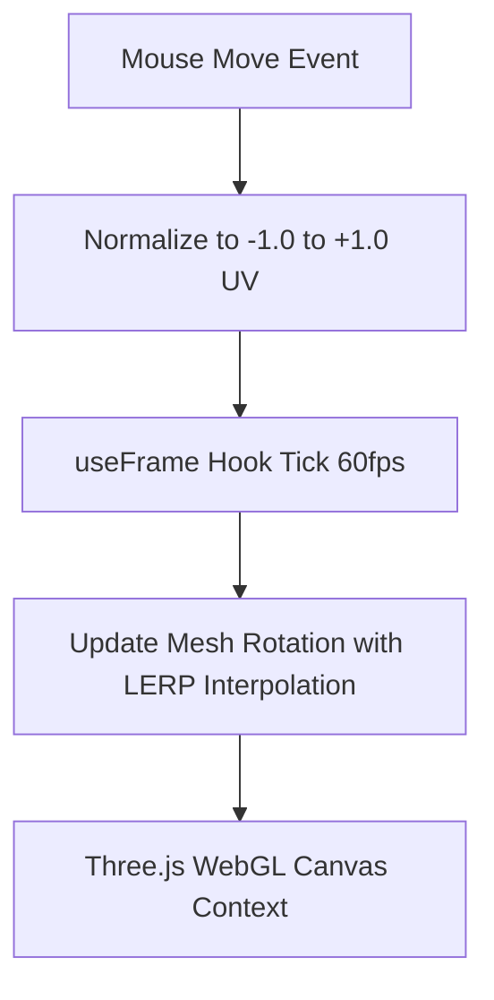
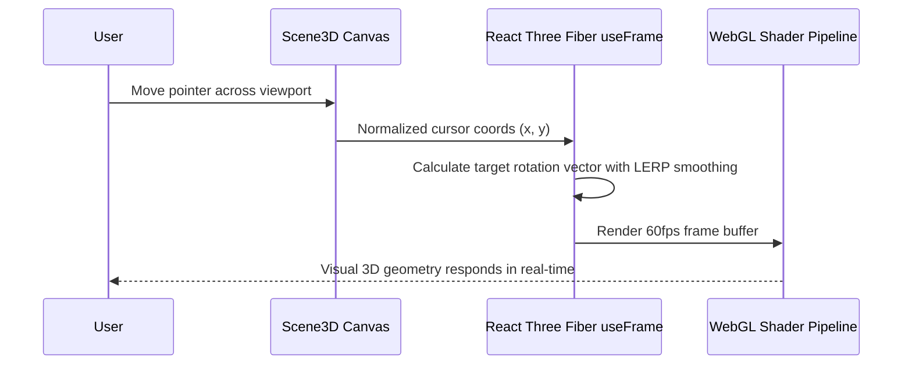

# F1: 3D Interactive Hero Canvas & Spatial Physics

## 1. Description & User Experience
When a user visits the landing page (`frontend/src/pages/home.jsx`), they are greeted by an interactive 3D hero element (`frontend/src/components/scene3d.jsx`). The 3D geometry smoothly rotates and translates in 3D coordinate space based on the user's cursor pointer vectors, illuminated by dynamic directional and ambient light sources.

## 2. Technical Architecture & File Flow

## 3. Sequence Diagram

## 4. Say It Out Loud
"For the landing experience, I built an interactive 3D hero canvas using Three.js and React Three Fiber. When the user moves their mouse, the component captures the normalized pointer coordinates and calculates smooth rotational vectors using linear interpolation inside an optimized 60fps frame loop. I chose React Three Fiber because it allows me to construct complex WebGL scene graphs declaratively while keeping performance locked at 60 frames per second. If WebGL is unavailable on older devices, it gracefully falls back to an elegant CSS gradient background. One limitation is mobile battery consumption under sustained interaction, which I would optimize by throttling the render loop when the window is out of view."
