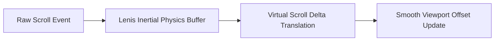

# F2: Kinetic Navigation & Smooth Scrolling

## 1. Description & User Experience
The platform provides a unified kinetic feel across every page. Natural scroll wheel movements are intercepted by Lenis (`frontend/src/components/smoothscroll.jsx`) to produce smooth inertial acceleration and deceleration. Interactive buttons wrapped in `magnetic.jsx` pull toward the cursor when hovered, creating a tactile physical connection.

## 2. Architecture & Physics Calculations

## 3. Say It Out Loud
"I implemented a kinetic micro-interaction system combining Lenis smooth scrolling with magnetic physics buttons. When the user scrolls, Lenis intercepts the raw wheel event and applies a custom cubic easing equation to ensure fluid momentum across long technical articles. For interactive buttons, I built a custom magnetic component using GSAP springs that calculates the distance between the cursor and the element's center point, creating an attractive pull effect. I chose this over basic CSS hover states because it makes the web app feel alive and responsive. If a user enables 'prefers-reduced-motion' in their system settings, the system automatically bypasses the physics calculations to respect accessibility standards."
