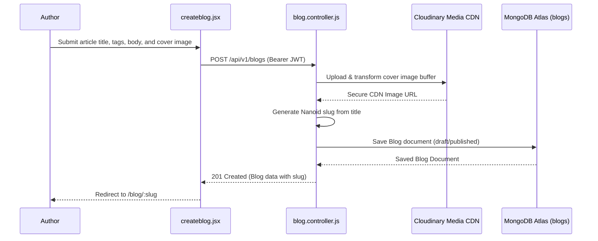

# F3: Rich Draft & Markdown Story Publishing Engine

## 1. Description & Workflow
Authors can draft and publish articles with rich text, code snippets, tags, and cover images (`frontend/src/pages/createblog.jsx`). The backend creates a URL-friendly, collision-resistant slug using Nanoid, uploads the banner to Cloudinary, and saves the article document in MongoDB Atlas.

## 2. Sequence Diagram

## 3. Say It Out Loud
"I built the article publishing engine to allow creators to write, preview, and publish technical stories with automated asset pipelines. When the user submits their story, the Express backend verifies their JWT session, dispatches the cover image to Cloudinary for automatic format conversion and CDN delivery, and generates a clean, URL-safe slug using Nanoid. I chose Nanoid over standard sequential IDs because it guarantees collision resistance without exposing sequential database sizes to competitors. When an upload fails, the transaction is cleanly aborted with a descriptive error message so the author never loses their written draft."
