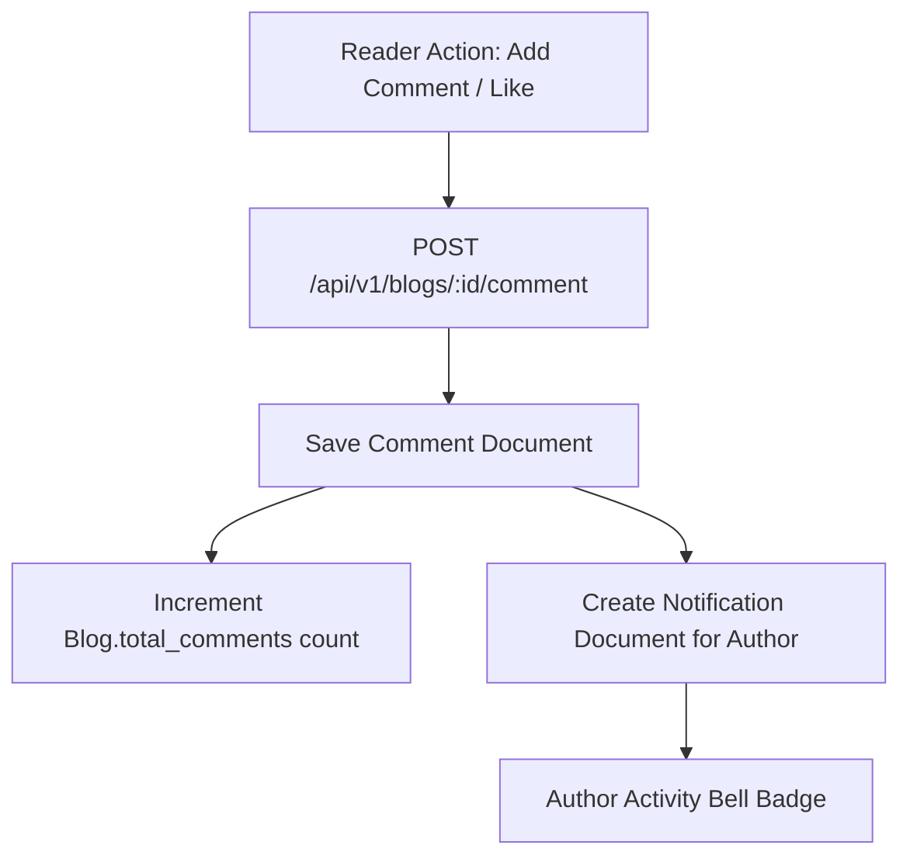

# F4: Social Community Graph & Threaded Comments

## 1. Description & User Interaction
Readers can interact with stories through applause reactions and threaded comments (`frontend/src/pages/blogdetail.jsx`). Whenever an article receives an upvote or a comment, the backend dispatches an automated notification to the author's activity feed (`backend/models/notification.model.js`).

## 2. Data Flow

## 3. Say It Out Loud
"To foster community interaction, I developed a threaded comment and notification pipeline. When a reader leaves feedback or applauds an article, the backend executes an atomic update on the blog document to increment engagement metrics, persists the comment record, and automatically generates an activity notification for the author. I chose atomic MongoDB operators like `$inc` and `$push` to prevent race conditions during viral traffic spikes. If the notification creation fails, the core comment still succeeds so the reader experience is never disrupted."
