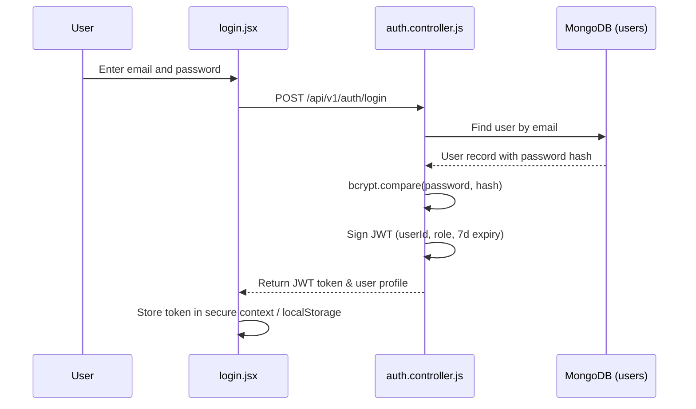

# F5: Cryptographic User Authentication & JWT Identity Protection

## 1. Description & Security
The authentication system secures user registration, login, and author privilege delegation (`backend/controllers/auth.controller.js`). User passwords are protected with salted bcrypt hashes (10 rounds), and authenticated sessions are maintained via signed HS256 JSON Web Tokens.

## 2. Authentication Flow Diagram

## 3. Say It Out Loud
"I engineered a stateless JWT authentication system to protect user identities and author publishing permissions. During registration, passwords are salted and hashed using bcrypt with an adaptive work factor of 10 to protect against brute-force attacks. Upon successful authentication, the server signs an HS256 JWT containing the user's unique identifier and role. Protected endpoints pass through an authorization middleware that validates the token signature before invoking the controller. I chose stateless JWTs over server-side session stores to enable horizontal scaling across multiple instances without sticky session bottlenecks."
